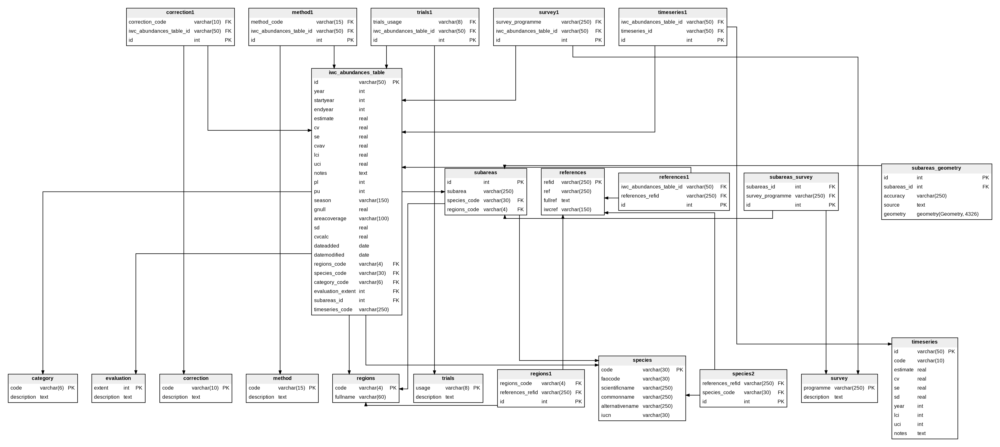

# IWC Abundance Estimates Database: PostgreSQL/PostGIS

This folder contains the scripts, schema, database-model documentation and entity-relationship diagram used to create and populate the **IWC abundance estimates PostgreSQL/PostGIS database**.

The PostgreSQL/PostGIS database is built from the **final quality-controlled outputs** produced elsewhere in the repository. It does not rebuild the database directly from the legacy Excel workbooks.

## Database model

The database was designed for PostgreSQL with PostGIS.

The executable schema is defined in:

- `iwc_abundances_table_create.sql`

Detailed documentation of the model is provided in:

- `iwc_abundances_table-data_model.docx`

The Word document describes every database table and field, including:

- field names and PostgreSQL data types;
- primary and foreign keys;
- descriptions of table and field contents;
- relationships between tables;
- the time-series structure;
- the separation of logical subareas from their polygon geometries; and
- the survey relationships associated with abundance records and subareas.

A visual overview of the complete schema is provided in:



The central table is `iwc_abundances_table`. It contains the quality-controlled abundance estimates and associated metadata. It links directly to single-value reference tables and through junction tables where more than one value may apply.

### Main table

- `iwc_abundances_table` — abundance estimates and associated metadata

### Reference and lookup tables

- `category` — ASI abundance-estimate categories
- `correction` — corrections applied to abundance estimates
- `evaluation` — ASI evaluation extent
- `method` — data and analytical methods used to estimate abundance
- `references` — source publications and IWC references
- `regions` — large marine regions
- `species` — species reference information
- `survey` — survey programmes
- `trials` — use of estimates in simulation trials or management procedures
- `subareas` — logical spatial subareas used by abundance records

### Junction and relational tables

- `correction1` — abundance records ↔ corrections
- `method1` — abundance records ↔ methods
- `references1` — abundance records ↔ literature references
- `regions1` — literature references ↔ regions
- `species2` — literature references ↔ species
- `survey1` — abundance records ↔ survey programmes
- `trials1` — abundance records ↔ trials
- `timeseries1` — abundance records ↔ individual time-series records
- `subareas_survey` — logical subareas ↔ survey programmes

### Spatial table

- `subareas_geometry` — individual polygon features belonging to logical subareas

### Time-series table

- `timeseries` — individual estimates belonging to documented abundance time series

## Files in this folder

### `turn files into a postgis database.R`

Main database-build script.

It:

1. connects to PostgreSQL;
2. drops and recreates the target database;
3. enables PostGIS;
4. creates the database schema from `iwc_abundances_table_create.sql`;
5. imports the final reference tables;
6. reads the final subarea shapefile;
7. constructs the logical `subareas` table;
8. creates `subareas_survey` and `subareas_geometry`;
9. imports the final main abundance table and links records to logical subareas;
10. imports the final literature-reference table;
11. creates the required reference and coded-value junction tables;
12. imports `timeseries` and `timeseries1`; and
13. closes the database connection.

> **Warning:** the script uses `DROP DATABASE IF EXISTS` followed by `CREATE DATABASE`. Running it will delete and recreate any existing database with the name specified in `db_name`.

### `junction tables.R`

Contains the functions used to create junction and related relational tables.

`refs_f()` creates `references1` by matching references used by abundance records to the literature-reference table using:

- region;
- species; and
- citation text.

The import stops if an abundance-reference relationship cannot be resolved.

`inter_f()` creates:

- `correction1`;
- `method1`;
- `survey1`; and
- `trials1`.

Values containing more than one code are split on `+`.

`regions1_f()` creates the reference-region relationships in `regions1`.

`species2_f()` creates the reference-species relationships in `species2`.

`subareas_survey_f()` creates the relationships between logical subareas and individual survey programmes. Combined survey values such as `JARPA+JARPAII` are split into separate relationships.

`subareas_geometry_f()` links every original polygon feature to its logical subarea while retaining the individual polygon geometries.

### `iwc_abundances_table_create.sql`

Defines the PostgreSQL/PostGIS schema, including:

- tables;
- PostgreSQL data types;
- primary keys;
- foreign keys; and
- uniqueness constraints.

This is the schema executed by the main R database-build script.

### `iwc_abundances_table-data_model.docx`

Detailed human-readable documentation of the database model.

It should be used when field-level information is required rather than only the structural overview shown in the ER diagram. It documents the purpose and structure of each table, all fields and data types, key relationships, and the spatial design.

### `iwc_abundances_table.png`

Entity-relationship diagram of the complete PostgreSQL/PostGIS database.

It provides a visual overview of the central abundance table, reference tables, junction tables, time-series tables and spatial tables.

## Required input files

The database-build script uses the final outputs from the database preparation and QC workflow.

### Main and time-series tables

```text
tables/outputs/
├── main_abundances_table.csv
├── literature_references.csv
├── timeseries.csv
└── timeseries1.csv
```

### Reference tables

```text
tables/outputs/reference_tables/
├── category.csv
├── correction.csv
├── evaluation.csv
├── method.csv
├── regions.csv
├── species.csv
├── survey.csv
└── trials.csv
```

### Spatial subareas

```text
subareas/
└── subareas.shp
```

All associated shapefile components must also be present, including the corresponding `.dbf`, `.shx` and `.prj` files.

The database-build script transforms the spatial layer to **WGS 84 / EPSG:4326** if required.

## Software requirements

### PostgreSQL

A PostgreSQL installation with the **PostGIS** extension available is required.

The database connection settings are defined near the start of `turn files into a postgis database.R`:

```r
db_name <- "iwcabundances"
db_user <- "postgres"
db_password <- "postgres"
db_host <- "localhost"
db_port <- 5432
```

Change these values if required for the local PostgreSQL installation.

Do **not** commit real database passwords or other credentials to a public repository.

### R

The database-build scripts use:

```r
RPostgres
DBI
sf
tidyverse
tidyr
```

These can be installed with:

```r
install.packages(c(
  "RPostgres",
  "DBI",
  "sf",
  "tidyverse",
  "tidyr"
))
```

## Running the database build

The script should be run from the **root of the repository**, because the input and script paths are relative to the repository root.

From R:

```r
source("postgrSQLDB/turn files into a postgis database.R")
```

A successful build ends with:

```text
Database setup and data import completed successfully!
```

## Data import workflow

The PostgreSQL/PostGIS build is the final stage of the database workflow.

```text
Final QC-controlled tabular outputs
tables/outputs/
        |
        +----------------------------+
        |                            |
        v                            v
Reference tables             Main abundance table
        |                            |
        |                            +----------------------+
        |                                                   |
        v                                                   v
PostgreSQL reference tables                       logical subarea matching
                                                            |
Final subarea shapefile                                    v
subareas/subareas.shp                              iwc_abundances_table
        |                                                   |
        v                                                   +--> references1
logical subareas                                             +--> correction1
        |                                                    +--> method1
        +--> subareas_survey                                 +--> survey1
        |
        +--> subareas_geometry                               +--> trials1
                                                             +--> timeseries1

Final literature references
        |
        +--> references
        +--> regions1
        +--> species2

Final time-series outputs
        |
        +--> timeseries
        +--> timeseries1
```

## Data-integrity checks during database construction

The main data validation occurs before this stage, when the final QC-controlled output tables are produced.

The PostgreSQL/PostGIS build nevertheless performs additional relational checks intended to prevent ambiguous or incomplete imports.

### Duplicate abundance IDs

`iwc_abundances_table.id` must be unique.

The build stops if duplicate abundance record IDs are found.

### Subarea matching

Each abundance record is matched to one logical subarea using:

- subarea;
- survey programme;
- species code; and
- region code.

The import stops if an abundance record cannot be matched to a logical subarea.

The resulting join is also checked to ensure that spatial matching has not duplicated abundance records.

### Duplicate reference IDs

`references.refid` is the primary key of the `references` table.

The build stops if duplicated `refid` values are found in the final literature-reference table.

### Reference matching

References listed in the abundance table are split on `;` and matched to literature-reference records using:

- region;
- species; and
- citation text.

The import stops if an abundance-reference relationship cannot be resolved.

### Survey validation for subareas

Survey programmes associated with logical subareas are checked against the `survey` reference table.

The import stops if a survey programme used by a subarea does not exist in the reference table.

### Spatial-feature matching

Every polygon feature in the final subarea shapefile must link to a logical `subareas` record.

The import stops if one or more spatial features cannot be linked.

## Spatial data

The current database model deliberately separates **logical subarea identity** from **spatial geometry**.

### `subareas`

Contains one record for each logical subarea used by abundance records.

The PostgreSQL table stores:

- `id`;
- `subarea`;
- `species_code`; and
- `regions_code`.

Survey information is not stored directly in this table. It is represented through `subareas_survey`.

### `subareas_geometry`

Stores the individual polygon features belonging to logical subareas.

The geometry field is:

```sql
geometry(Geometry, 4326)
```

A logical subarea may have more than one polygon record.

The polygons are deliberately **not dissolved into `MULTIPOLYGON` geometries** during database construction. This preserves separate polygon features, including spatial definitions represented by polygons on opposite sides of the 180-degree meridian.

### `subareas_survey`

Links logical subareas to individual survey programmes.

A source value such as:

```text
JARPA+JARPAII
```

is represented as two relationships:

```text
subarea -> JARPA
subarea -> JARPAII
```

The same normalisation principle is used in `survey1` for abundance records.

## Notes on database identifiers

The database relies on stable identifiers and reference codes to preserve relationships between tables.

In particular:

- `iwc_abundances_table.id` uniquely identifies an abundance estimate;
- `references.refid` uniquely identifies a bibliographic reference;
- `species.code` identifies species;
- `regions.code` identifies large regions;
- `survey.programme` identifies survey programmes;
- `subareas.id` identifies logical subareas; and
- `timeseries.id` is a permanent character identifier for an individual time-series record.

Changes to these identifiers in the final input files should therefore be made carefully because they can affect foreign-key and junction-table relationships.

## Folder organisation

```text
postgrSQLDB/
├── README.md
├── iwc_abundances_table_create.sql
├── iwc_abundances_table-data_model.docx
├── iwc_abundances_table.png
├── turn files into a postgis database.R
└── junction tables.R
```

The source data used by these scripts are stored elsewhere in the repository under `tables/outputs/` and `subareas/`.

## Database documentation

For a visual overview of the schema, see:

- `iwc_abundances_table.png`

For detailed descriptions of individual tables, columns, data types and relationships, see:

- [`iwc_abundances_table-data_model.docx`](iwc_abundances_table-data_model.docx)

For the executable database definition, see:

- [`iwc_abundances_table_create.sql`](iwc_abundances_table_create.sql)

The scripts in this folder take the final quality-controlled IWC abundance database outputs and create the PostgreSQL/PostGIS database.
