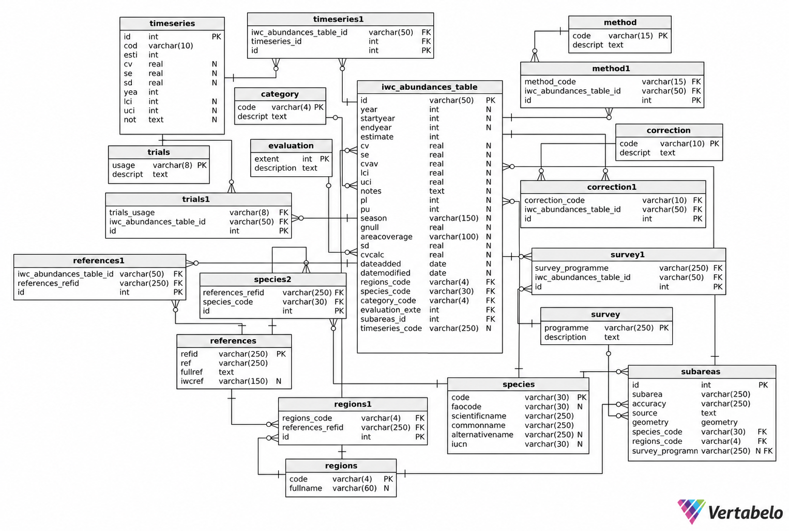

# IWC Abundance Estimates Database: Schema and PostgreSQL/PostGIS 

This folder contains the scripts and database schema used to create and populate the **IWC abundance estimates PostgreSQL/PostGIS database** from the IWC abundance Excel workbooks, reference tables, and subarea shapefiles.

The workflow converts the source files into a relational database containing abundance estimates, species and region information, survey programmes, methods, corrections, references, management/trial use, time-series data, and spatial subareas.

## Database model

The database was designed for PostgreSQL/PostGIS. The schema is defined in:

- `iwc_abundances_table_create.sql`
- `iwc_abundances_table-data_model.docx`

A visual overview of the schema is also available in this folder:



The central table is `iwc_abundances_table`. It is linked to reference tables directly or through junction tables where an abundance estimate can be associated with more than one value.

### Main table

- `iwc_abundances_table` — abundance estimates and associated metadata

### Reference tables

- `category` — ASI abundance-estimate categories
- `correction` — corrections applied to abundance estimates
- `evaluation` — ASI evaluation extent
- `method` — data/analytical methods used to estimate abundance
- `references` — source publications and IWC references
- `regions` — large marine regions
- `species` — species reference information
- `subareas` — spatial subareas and their geometries
- `survey` — survey programmes
- `trials` — use of estimates in simulation trials or management procedures

### Junction tables

- `correction1`
- `method1`
- `references1`
- `regions1`
- `species2`
- `survey1`
- `timeseries1`
- `trials1`

### Time-series table

- `timeseries` — individual abundance estimates belonging to documented time series

## Scripts

### `turn files into a postgis database.R`

Main script. It:

1. connects to PostgreSQL;
2. drops and recreates the `iwcabundances` database;
3. enables PostGIS;
4. creates the database schema from `iwc_abundances_table_create.sql`;
5. imports the reference tables;
6. imports and combines the subarea shapefiles;
7. imports abundance estimates from the regional Excel workbooks;
8. links abundance records to spatial subareas;
9. imports bibliographic references;
10. creates the required junction tables;
11. imports the time-series data; and
12. writes all tables to PostgreSQL.

> **Warning:** the current script uses `DROP DATABASE IF EXISTS iwcabundances`. Running it will delete and recreate an existing database with that name.

### `read_excel_tables.R`

Functions for reading:

- the main abundance-estimate worksheets;
- the `references` worksheets; and
- the Excel workbook containing the database reference tables.

The regional abundance workbooks are combined into a single data frame before being written to the database.

### `read_excel_sheets_with_types.R`

Helper function used by `read_excel_tables.R`.

It:

- selects the required worksheets;
- checks for required columns;
- selects and reorders database fields; and
- converts columns to the expected R data types.

At present, a worksheet with missing required columns is skipped with a warning.

### `junction tables.R`

Functions used to construct relational junction tables.

`refs_f()` creates `references1` by matching references in the abundance tables to the reference records using region, species, and reference citation. The function trims whitespace, checks that abundance-table references can be matched, and stops the import if unmatched references are found.

`inter_f()` creates the junction tables for:

- corrections;
- methods;
- survey programmes; and
- trials.

Values containing multiple codes are split on `+`.

### `timeseries_tables.R`

Creates:

- the `timeseries` table; and
- the `timeseries1` junction table linking time-series records to abundance records.

Time-series data are read from the `timeseries` worksheet in each regional abundance workbook.

## Required input files

The scripts currently expect the following source files to be available in the working directory.

### Abundance workbooks

```text
abundances-NA.xlsx
abundances-NP.xlsx
abundances-SH.xlsx
```

Each workbook contains the abundance-estimate worksheets and a `references` worksheet. The scripts also expect a `timeseries` worksheet.

The abundance sheets currently considered are:

```text
Mi
Fin
Hbk
Sei
Spr
NArht
Bow
Blu
Other
Gray
Brd
AMi
blue
Srht
Abund-Small
```

Only worksheets that are present in a workbook are read.

### Reference tables

```text
reference tables.xlsx
```

The following worksheets are imported into the database:

```text
category
correction
evaluation
method
regions
species
survey
trials
```

Worksheet names must match the corresponding PostgreSQL table names.

### Subarea spatial files

```text
NA-subareas.shp
NP-subareas.shp
SH-subareas.shp
```

All associated shapefile components must also be present, including the corresponding `.dbf`, `.shx`, and `.prj` files.

The geometries are transformed to **WGS 84 / EPSG:4326** before being written to PostGIS.

## Software requirements

### PostgreSQL

A local PostgreSQL installation with the **PostGIS** extension available is required.

The main script currently uses:

```r
db_name <- "iwcabundances"
db_user <- "postgres"
db_password <- "postgres"
db_host <- "localhost"
db_port <- 5432
```

Change these values for your local PostgreSQL installation before running the script.

Do **not** commit real database passwords or other credentials to a public repository.

### R

The scripts use the following R packages:

```r
RPostgres
DBI
readxl
sf
tidyverse
dplyr
tidyr
```

They can be installed with:

```r
install.packages(c(
  "RPostgres",
  "DBI",
  "readxl",
  "sf",
  "tidyverse",
  "dplyr",
  "tidyr"
))
```

## Running the database build

Place the scripts and required input files in the same working directory, or modify the paths in the scripts accordingly.

From R:

```r
source("turn files into a postgis database.R")
```

or from a terminal:

```bash
Rscript "turn files into a postgis database.R"
```

A successful build ends with:

```text
Database setup and data import completed successfully!
```

## Data import workflow

The main workflow is:

```text
Excel reference tables
        |
        v
PostgreSQL reference tables
        |
        +----------------------+
        |                      |
        v                      v
Regional abundance         Subarea shapefiles
Excel workbooks            NA / NP / SH
        |                      |
        v                      v
Combined abundance data -> spatial subarea matching
        |
        v
iwc_abundances_table
        |
        +--> references1
        +--> correction1
        +--> method1
        +--> survey1
        +--> trials1
        +--> timeseries1
```

Bibliographic reference records are also used to create the `regions1` and `species2` junction tables.

## Data-integrity checks

The current workflow includes several checks intended to prevent incomplete or ambiguous imports.

### Subarea matching

Each abundance record is matched to a subarea using:

- subarea;
- survey programme;
- species code; and
- region code.

The import stops if an abundance record cannot be matched to a spatial subarea.

### Duplicate reference IDs

`refid` is the primary key of the `references` table.

The main script checks for duplicated `refid` values across the regional reference worksheets and stops the database build if duplicates are found.

### Reference matching

References listed in the abundance tables are split on `;` and matched to records in the references tables using:

- region;
- species; and
- citation text.

Whitespace is removed before matching. The import stops if an abundance-reference relationship cannot be resolved.

### Multiple-value fields

Fields such as correction, method, survey, trials, region, species, and time-series codes may contain more than one value. Multiple codes are separated using `+` and are expanded into the corresponding junction tables.

## Current validation notes

The following behaviours should be kept in mind when updating the scripts:

- `read_excel_sheets_with_types.R` currently **warns and skips** a worksheet if required columns are missing rather than stopping the complete import.
- `timeseries_tables.R` currently uses an inner join to link `timeseries_code` values. A code that is present in the abundance table but absent from the time-series table can therefore be omitted from the junction table unless an additional validation check is added.
- When modifying junction-table code, it is advisable to ensure that duplicate relationships are removed before assigning junction-table IDs.
- The matching fields used to identify subareas should uniquely identify a single subarea record.

## Spatial data

`subareas` is a PostGIS spatial table. The database schema stores geometries as:

```sql
geometry(Geometry, 4326)
```

Subarea polygons from the three regional shapefiles are grouped and geometries belonging to the same subarea definition are combined with `st_union()` before import.

## Notes on database identifiers

The database relies on stable identifiers and reference codes to preserve relationships between tables. In particular:

- `iwc_abundances_table.id` uniquely identifies an abundance estimate;
- `references.refid` uniquely identifies a bibliographic reference;
- `species.code` identifies species;
- `regions.code` identifies regions;
- `survey.programme` identifies survey programmes; and
- `subareas.id` identifies spatial subareas.

Changes to these identifiers in source files should therefore be made carefully because they can affect foreign-key and junction-table relationships.

## Repository organisation

A suggested organisation for this folder is:

```text
database/
├── README.md
├── iwc_abundances_table_create.sql
├── iwc_abundances_table-data_model.docx
├── iwc_abundances_table.png
├── turn files into a postgis database.R
├── read_excel_tables.R
├── read_excel_sheets_with_types.R
├── junction tables.R
└── timeseries_tables.R
```

Source Excel workbooks and shapefiles can either be kept in the same directory, as expected by the current scripts, or moved into a separate data directory if the paths in the scripts are updated.

For large, sensitive, or frequently updated source datasets, consider keeping the source files outside the Git repository and documenting where they can be obtained instead.

## Database documentation

For detailed descriptions of individual tables, columns, and relationships, see:

- [`iwc_abundances_table-data_model.docx`](iwc_abundances_table-data_model.docx)
- [`iwc_abundances_table_create.sql`](iwc_abundances_table_create.sql)

The database model was generated using Vertabelo.
The scripts in this folder take the data of the IWC abundances tables and turn them into a postgreSQL database. The main script to run is 'turn files into a postgis database.R'. 
